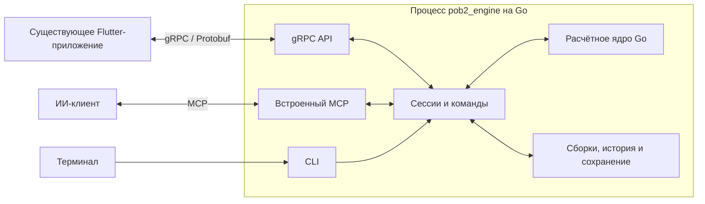

# pob2_engine

Самостоятельный движок расчётов Path of Exile 2 на **Go**, со встроенными **CLI** и **MCP**. Существующее приложение [PoB II на Flutter](https://github.com/Hecatoncheir/pob2_ui) будет подключаться к нему через **gRPC / Protobuf**.

**Состояние на 20 ноября 2026 года: работает первый сервис сессий на Go с CLI, gRPC и MCP stdio.** Два клиента могут создать сессию, получить снимок и переименовать сборку с проверкой ревизии и повторов команд. Расчётное ядро и подключение Flutter ещё не реализованы. Сессии хранятся только в памяти; сервер пока работает в постоянном режиме.

Рабочие команды, контракт, ограничения и порядок генерации Go/Dart API — в [руководстве сервиса сессий](docs/SESSION-API.md). Разделы ниже описывают целевую архитектуру; не все её компоненты уже реализованы.

Порядок реализации и критерии готовности — в [TODO.md](TODO.md), история изменений — в [CHANGELOG.md](CHANGELOG.md).

## Назначение

Движок должен работать без Flutter и без графического окна: рассчитывать сборки, сравнивать варианты экипировки и умений, обслуживать CLI и MCP-клиентов. Открытое Flutter-приложение показывает ту же сессию и получает изменения через поток событий. Через встроенный MCP можно управлять как сборкой, так и подключённым приложением.

Целевые платформы первого этапа: Windows x64, Linux x64 и macOS arm64. Ядро и сервер реализуются на Go; интерфейс остаётся на Dart/Flutter. Базовый вариант сборки — Go без cgo. Производительность и расход памяти оцениваются измерениями на одинаковых сборках.

## Источники и связь с PoB

| Проект | Роль |
| --- | --- |
| [PathOfBuildingCommunity/PathOfBuilding-PoE2](https://github.com/PathOfBuildingCommunity/PathOfBuilding-PoE2) | Источник игровых данных, расчётных правил и эталонных результатов Lua |
| [Hecatoncheir/pob-poe2-mcp](https://github.com/Hecatoncheir/pob-poe2-mcp) | Существующий Python/Lua-адаптер; источник контрактов инструментов и доступа к эталонным расчётам |
| [Hecatoncheir/pob2_ui](https://github.com/Hecatoncheir/pob2_ui) | Существующее приложение Flutter, которое будет подключено к новому движку |
| Этот репозиторий | Новый Go-движок, сессии, CLI, gRPC API и встроенный MCP |

На момент составления плана в PoB II 0.12.0 закреплена следующая пара:

- PoB `v0.23.1`, commit `7d6f530cbdab20389ff8bc6ba97a37ac27f74e41`;
- MCP `v0.23.0`, commit `1b3f61dc00016fe3bc86d889d6f4992302231d75`;
- исходная ревизия UI: `07af97625b734d4f8e5369b1b3da19b9403b6b98`.

Проверяемый снимок пары: [components-lock.json](https://github.com/Hecatoncheir/pob2_ui/blob/07af97625b734d4f8e5369b1b3da19b9403b6b98/tool/components-lock.json). При начале реализации нужно проверить актуальность версий. Локальные рабочие копии PoB и MCP могут отличаться от закреплённых ревизий.

В PoB есть два разных слоя: данные, извлекаемые из клиента игры и преобразуемые экспортёрами, и алгоритмы расчётов, написанные разработчиками PoB. [Инструкция экспорта](https://github.com/PathOfBuildingCommunity/PathOfBuilding-PoE2/blob/dev/CONTRIBUTING.md#exporting-ggpk-data-from-path-of-exile) описывает происхождение генерируемых файлов. Экспорт данных сам по себе не даёт готовой расчётной логики.

Выбран постепенный перенос алгоритмов на обычный типизированный Go с автоматизацией импорта данных. Полная автоматическая трансляция Lua в Go не является принятой архитектурой. В конечной поставке Go-движок заменит текущую связку Lua и Python; во время переноса Lua остаётся эталоном и может использоваться отдельным адаптером. Неподдержанные возможности должны возвращать явный статус. Исходники PoB хранятся отдельно; для заимствованного кода и данных нужно сохранить применимые лицензии и сведения об источниках.

## Архитектура



Расчётное ядро не зависит от gRPC, MCP и Flutter. Все способы управления используют общий слой команд. Адаптеры, работающие в одном процессе с сервисом, вызывают его напрямую. При подключении CLI или MCP к уже запущенному серверу используется gRPC-клиент того же Go-приложения.

### gRPC и общая сессия

Контракт описывается в `.proto`; из него генерируются Go- и Dart-типы. Транспортные структуры отделяются от моделей ядра. Изменения схемы проверяются на совместимость.

| Предлагаемый сервис | Ответственность |
| --- | --- |
| `SessionService` | Создание и открытие сессий, регистрация клиентов, снимки и подписки |
| `BuildService` | Экипировка, умения, дерево, условия, импорт и экспорт |
| `CalculationService` | Расчёты, сравнения, фоновые задачи, прогресс и отмена |
| `UiBridge` | Подключение Flutter, команды интерфейса и результаты их выполнения |

Сервис Go владеет состоянием сборки. Приложение, MCP и CLI работают с явно выбранным `session_id`. Изменения выполняются последовательно внутри сессии; независимые сравнения могут рассчитываться параллельно по неизменяемым снимкам.

Команды содержат ожидаемую ревизию и идентификатор запроса. Повтор запроса после обрыва соединения не должен повторно применять правку. Принятое изменение увеличивает ревизию и отправляется подписчикам. После разрыва потока клиент повторно подписывается и получает актуальный снимок либо доступные события с нужного номера. Восстановление этого состояния реализуется на уровне приложения.

### Управление Flutter через MCP

Команды сборки доступны без графического интерфейса. Команды окон, разделов, диалогов, форм, клавиатуры, мыши и снимков доступны при подключённом Flutter-приложении и разрешённом доступе. Доступность отражается в `capabilities`.

Flutter сам открывает двусторонний поток `UiBridge`: получает команды интерфейса и отправляет результаты. Отдельный входящий gRPC-сервер в Flutter для этого не требуется. При отключённом UI такие команды возвращают явный статус недоступности.

Нужно сохранить возможности существующего [MCP редактора](https://github.com/Hecatoncheir/pob2_ui/blob/07af97625b734d4f8e5369b1b3da19b9403b6b98/docs/MCP-EDITOR.md): сборки, библиотеку, файлы, заметки, историю, прокачку, компоненты, настройки и действия интерфейса. Операции, сейчас связанные с `WorkshopCubit`, постепенно выносятся в общий сервис; Flutter сохраняет обработчики собственных виджетов. Системные файловые диалоги обслуживаются файловыми командами с явным путём.

MCP остаётся отдельным внешним протоколом. Для локальных ИИ-клиентов предусмотрен `stdio`; сообщения протокола идут в stdout, журналы — в stderr. Расчётный код не дублируется в MCP-адаптере. В качестве основы рассматривается [официальный Go SDK](https://github.com/modelcontextprotocol/go-sdk).

## Запуск и время жизни сервера

При запуске Flutter ищет совместимый сервер выбранного профиля, проверяет протокол и регистрирует клиента. Если сервера нет, приложение запускает его и ждёт готовности. Конкурирующие запуски защищаются межпроцессной блокировкой. Обнаружение использует файл подключения с идентификатором экземпляра, адресом, версией протокола и токеном; одного PID недостаточно.

Локальный gRPC-сервер слушает `127.0.0.1` на автоматически выбранном порту. Токен и файл подключения защищаются правами пользователя. Открытие сервера для удалённых компьютеров не входит в первый этап.

| Режим жизни | Поведение |
| --- | --- |
| Автоматический, запущен Flutter | Завершается после отключения последнего клиента и окончания активных задач с небольшой задержкой для переподключения |
| Постоянный, запущен вручную | Продолжает работу без клиентов до явной остановки |

Режим хранится в самом сервере. Если приложение А запустило сервер, затем подключилось Б, закрытие А сохраняет работу сервера. После закрытия Б автоматический сервер завершает себя. MCP- и CLI-клиенты также учитываются; фоновая задача может удерживать сервис до своего завершения.

Учёт ведётся по зарегистрированным клиентам и арендам с подтверждением активности. Количество TCP-соединений и открытых RPC не является количеством приложений. Аварийное закрытие клиента освобождает аренду после таймаута. Перед переходом к завершению сервер повторно проверяет клиентов и задачи под общей синхронизацией. Поведение при закрытии приложения с запущенной задачей определяется явно: дождаться результата либо отменить задачу; подтверждённые правки сохраняются.

### Graceful shutdown

Единый механизм завершения используется при автоматической остановке, явной команде и поддерживаемых сигналах ОС:

1. Атомарно перейти в `draining`, остановить приём новых задач и регистрацию клиентов.
2. Уведомить клиентов о завершении сервера.
3. Дать начатым операциям ограниченное время на завершение; поддерживать отмену длительных расчётов.
4. Зафиксировать подтверждённые изменения, закрыть хранилища и сбросить журналы.
5. Явно завершить длительные подписки и `UiBridge`, затем корректно остановить gRPC и остальные ресурсы.
6. Удалить собственный файл подключения, освободить блокировку экземпляра и завершить процесс.

Общий настраиваемый таймаут ограничивает ожидание. По его истечении оставшиеся задачи отменяются и соединения закрываются принудительно. Повторный запрос остановки безопасен; прерванная операция не выдаёт успешный результат. Завершение потоков должно предшествовать ожиданию остановки gRPC, чтобы постоянная подписка не удерживала процесс бесконечно. Удалять можно только файл подключения своего экземпляра.

Запускающееся приложение, обнаружив `draining`, ждёт завершения старого экземпляра и под блокировкой запускает новый. Обработка сигналов и принудительного завершения учитывает различия Windows, Linux и macOS.

## Перенос и обновление расчётов

Первый расчётный этап — один воспроизводимый сценарий: предметы и пассивы → модификаторы → характеристики → урон выбранного умения. Go и исходный Lua получают одинаковые XML, конфигурацию, выбранное умение и версию данных.

Сравниваются показатели, промежуточные расчёты, предупреждения, ошибки камней и неподдержанные модификаторы. Допуски задаются для конкретных величин; расхождения исследуются. Успешное сравнение с PoB не означает проверку сборки в игре.

Обновления привязываются к выпускам PoB, включая исправления между лигами. Предлагаемый процесс:

```text
Новый выпуск PoB → закрепление commit → анализ данных и алгоритмов
→ импорт / генерация данных → перенос изменившейся логики
→ сравнение с Lua → сборка кандидата → проверка → активация
```

Новая версия устанавливается отдельно. При несовместимости или расхождениях остаётся рабочая версия; откат сохраняет пользовательские сборки. Обновление алгоритмов требует нового исполняемого файла, а совместимые наборы данных могут обновляться отдельно после проверки схемы и контрольных сумм.

## Структура проекта

Уже существуют `cmd/pob2-engine`, `internal/application`, `internal/domain`, `internal/buildinfo`, `internal/transport/{cli,grpcapi,mcpapi}`, `internal/integration`, `api/pob2/v1`, `gen/go`, `gen/dart` и инструменты генерации в `tool/`. Остальные каталоги в схеме добавляются по мере реализации:

```text
api/pob2/v1/              .proto-контракты
cmd/pob2-engine/          точка входа Go
gen/go/                  сгенерированный Go API
gen/dart/                сгенерированный Dart API
internal/application/    сессии, команды, история, задачи
internal/domain/         модели сборки и правила
internal/engine/         расчётное ядро
internal/transport/      адаптеры CLI, gRPC и MCP
internal/lifecycle/      обнаружение, аренды, запуск и завершение
internal/storage/        сохранение и миграции
internal/upstream/       импорт данных и проверка версий PoB
testdata/                воспроизводимые сборки и эталонные результаты
```

Предлагаемый интерфейс CLI, который ещё предстоит реализовать:

```shell
pob2-engine calculate --input build.xml --json
pob2-engine serve --session main
pob2-engine mcp --attach main
pob2-engine shutdown --attach main
```

Флаги профиля, режима жизни и назначения сервера уточняются при реализации. Подключение к существующей сессии всегда должно быть явным; ошибка подключения не создаёт незаметно новую независимую сборку.

## Разработка и проверки

Требуется Go 1.27.4. Из корня:

```shell
gofmt -w .
go vet ./...
go test ./...
go build ./cmd/pob2-engine
go run ./cmd/pob2-engine --help
go run ./cmd/pob2-engine serve
```

`serve` выводит JSON с адресом и токеном подключения. `info`, `session create|get|rename`, `mcp --attach` и `shutdown` подключаются по явному адресу; `mcp --standalone` создаёт независимую сессию. Подробные примеры — в [руководстве](docs/SESSION-API.md). Для изменения `.proto` дополнительно нужны Buf 1.73.0 и Dart 3.14.0; обычная сборка Go использует сохранённый сгенерированный API.

## CI и выпуск по тегу

[CI](.github/workflows/ci.yml) запускается для изменений `main`, запросов на слияние и вручную. Он проверяет документацию и структуру, форматирование, `go vet`, модульные и процессные тесты на Windows, Linux и macOS, а также гонки на Linux. Отдельная задача проверяет Protobuf, совместимость с базовым контрактом `main`, воспроизводимость генерации Go/Dart API и анализ Dart-пакета. Локально выполненные проверки не заменяют запуск этой матрицы в GitHub Actions.

[Выпуск](.github/workflows/release.yml) запускается при отправке тега `v*`. Он повторяет CI и проверяет формат версии и соответствующий раздел `CHANGELOG.md`. Собираются самостоятельные файлы для Windows x64, Linux x64 и macOS arm64 с `CGO_ENABLED=0`; версия тега встраивается в `--version`. Каждый выпуск содержит архивы исходников и `SHA256SUMS`. Тег с суффиксом версии публикуется как предварительный выпуск. Наличие CLI пока означает готовность сервиса сессий; игровые расчёты ещё отсутствуют.

Порядок выпуска после добавления записи вида `## [0.1.0] - ГГГГ-ММ-ДД` в changelog и отправки изменений:

```shell
git tag -a v0.1.0 -m "Выпустить pob2_engine 0.1.0"
git push origin v0.1.0
```

Workflow проверяет, что commit тега входит в `main`; публикация выполняется после успешных проверок. Существующий GitHub Release не перезаписывается автоматически. Для изменения состава выпуска требуется новый тег версии. Движок ещё не выпущен; первоначальная настройка репозитория не создаёт релизный тег.

## Основная документация технологий

- [gRPC для Go](https://grpc.io/docs/languages/go/) и [Dart](https://grpc.io/docs/languages/dart/).
- [Protobuf: развитие схем](https://protobuf.dev/programming-guides/proto3/).
- [Официальный MCP Go SDK](https://github.com/modelcontextprotocol/go-sdk).
- [Graceful shutdown gRPC](https://grpc.io/docs/guides/server-graceful-stop/).
