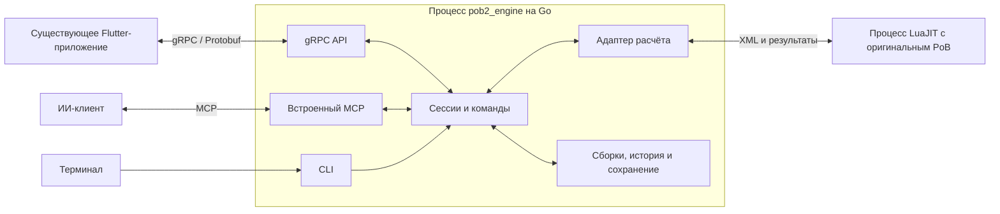

# pob2_engine

Движок Path of Exile 2 с сервисом сессий на **Go** и расчётами оригинального **Path of Building PoE2** на Lua. Управление доступно через **CLI**, **MCP** и **gRPC / Protobuf**. Приложение [PoB II на Flutter](https://github.com/Hecatoncheir/pob2_ui) подключается к общей сессии через gRPC в ветке `1.x.x`.

**Состояние на 23 ноября 2026 года.** Версия `0.0.8` использует оригинальные расчёты и каталог PoB на LuaJIT и устанавливает закреплённый PoB при первом запуске. Работают сервис сессий Go/CLI/gRPC/MCP, обнаружение сервера, аренды клиентов, автоматическое завершение, сохранение на диск и поток изменений. Прежние расчёты Fireball, Frostbolt и Spark на Go проверяются по 334 случаям Lua и доступны для сравнения. CLI, MCP и типизированный gRPC импортируют и редактируют XML, сохраняют расчёт, экспортируют и сравнивают варианты. Сессии, ревизии и первоначальные результаты команд восстанавливаются после перезапуска.

Выпущен [v0.0.1](https://github.com/Hecatoncheir/pob2_engine/releases/tag/v0.0.1).
[Итоговый отчёт](docs/RELEASE-0.0.1.md) содержит проверенные платформы, контрольные суммы и ограничения.

Выпущен [v0.0.2](https://github.com/Hecatoncheir/pob2_engine/releases/tag/v0.0.2).
[Приёмка финального выпуска](testdata/releases/0.0.2/README.md) подтвердила
архивы после скачивания на Windows x64, Linux x64 и macOS arm64.

В [0.0.4](todo_0.0.4.md) доступен полный [каталог активного PoB](docs/CATALOG.md)
и правки по его данным через CLI/MCP/gRPC. Для PoB v0.23.1 доступны 966 камней,
1504 базы предметов и 4544 пассива; предпросмотр принимает уровень и качество.
[Примеры Ice Nova](docs/EXAMPLES-0.0.4.md) проверены независимым Lua-эталоном.
Проверяйте `coverage`, статусы, ошибки камней и совместимость поддержек.
[Стабильный v0.0.4](https://github.com/Hecatoncheir/pob2_engine/releases/tag/v0.0.4)
[принят на трёх ОС](testdata/releases/0.0.4/README.md): опубликованные бинарники,
SHA-256, новые операции и восстановление сессий проверены до и после скачивания.

[Стабильный v0.0.5](https://github.com/Hecatoncheir/pob2_engine/releases/tag/v0.0.5)
добавляет проверку [многогрупповых сборок](docs/EXAMPLES-0.0.5.md) и правки
выбора групп и наборов. База `v0.0.4` восстанавливается с исходными
ответами запросов. [Итоговая приёмка на трёх ОС](testdata/releases/0.0.5/README.md).

[Выпуск 0.0.6](https://github.com/Hecatoncheir/pob2_engine/releases/tag/v0.0.6)
добавляет проверку PoB перед активацией и откат без сети. Сохранение сессий
после обновления и отката проверено на [трёх ОС](testdata/releases/0.0.6/README.md).
Команды и поля диагностики описаны в [руководстве выпуска](docs/RELEASE.md).

[Выпуск 0.0.7](https://github.com/Hecatoncheir/pob2_engine/releases/tag/v0.0.7)
создаёт сессию из XML в первой ревизии. Клиент
[pob2_ui/1.x.x](https://github.com/Hecatoncheir/pob2_ui/tree/1.x.x) открывает
общую сборку, синхронизирует уровень персонажа и показывает актуальный расчёт.
[Отчёт приёмки](testdata/releases/0.0.7/README.md) содержит нативные проверки
движка и клиента на Windows, Linux и macOS.

[Выпуск 0.0.8](https://github.com/Hecatoncheir/pob2_engine/releases/tag/v0.0.8)
добавляет точечную правку поддержки через CLI, MCP и gRPC. В окне общей сборки
PoB II доступны каталог, предпросмотр и применение. [Итоговая приёмка](testdata/releases/0.0.8/README.md)
содержит отчёты для трёх скачанных бинарников.

Клиент может подписаться на `WatchServer`, получить фазу и уведомление о
завершении. Остановка ограничена таймаутом; зависшая база не освобождает профиль
раньше фактического закрытия. Контракт описан в [руководстве жизненного цикла](docs/SERVER-LIFECYCLE.md#уведомление-об-остановке-по-grpc).

Рабочие команды, контракт, ограничения и порядок генерации Go/Dart API — в [руководстве сервиса сессий](docs/SESSION-API.md). Подписки, порядок событий и переподключение описаны в [руководстве событий](docs/SESSION-EVENTS.md). Разделы ниже описывают целевую архитектуру; не все её компоненты уже реализованы.

Обнаружение по профилю, автозапуск, heartbeat, защита файлов и учёт задач описаны в [руководстве жизненного цикла](docs/SERVER-LIFECYCLE.md). Сначала соберите CLI через `go build ./cmd/pob2-engine`, затем запустите `pob2-engine connect --profile main --start-server` (на Windows: `.\pob2-engine.exe`, на Linux/macOS: `./pob2-engine`).

Расположение базы, `--data-dir`, восстановление и обработка ошибок описаны в [руководстве хранения](docs/SESSION-STORAGE.md). Обычный `serve` использует профиль `default`; работа только в памяти задаётся явно через `--ephemeral`.

Выпущен [v0.0.3](https://github.com/Hecatoncheir/pob2_engine/releases/tag/v0.0.3) с оригинальным PoB на LuaJIT,
автоматической установкой и проверкой нативных бинарников.
[Стабильный выпуск принят на трёх платформах](testdata/releases/0.0.3/README.md).
Планы [v0.0.1](todo_0.0.1.md), [v0.0.2](todo_0.0.2.md), [v0.0.3](todo_0.0.3.md),
[v0.0.4](todo_0.0.4.md), [v0.0.5](todo_0.0.5.md), [v0.0.6](todo_0.0.6.md),
[v0.0.7](todo_0.0.7.md) и [v0.0.8](todo_0.0.8.md) описывают принятые выпуски.
Общая дорожная карта — [TODO.md](TODO.md), история изменений — [CHANGELOG.md](CHANGELOG.md).

Новый код распространяется по [MIT](LICENSE). Лицензии зависимостей, эталона,
порядок заимствований и комплект уведомлений описаны в
[THIRD_PARTY_NOTICES.md](THIRD_PARTY_NOTICES.md).

Числовой набор первого расчётного сценария встроен в Go. Формат, происхождение,
проверка и экспорт описаны в [DATASET.md](docs/DATASET.md).
Покрытие, формулы, диагностика и сравнение с Lua — в
[COVERAGE-0.0.1.md](docs/COVERAGE-0.0.1.md) и [CALCULATION.md](docs/CALCULATION.md).
Команды полной сборки, очередь, привязка результата и восстановление описаны
в [BUILD-COMMANDS.md](docs/BUILD-COMMANDS.md). Примеры использования и коды
завершения — в [CLI-BUILDS.md](docs/CLI-BUILDS.md).
В [0.0.11](todo_0.0.11.md) доступны выбор и смена атрибута пассива
с предпросмотром по расчётам PoB. [Приёмка на трёх ОС](testdata/releases/0.0.11/README.md).
Возможность `build.tree_sockets` обозначает назначение и снятие пустых
гнёзд самоцветов. `build.tree_jewels` добавляет установку и снятие предмета
в назначенном гнезде. `build.tree_specs` включает переключение существующих
спецификаций с проверкой класса через Lua. [Контракт правки дерева](docs/BUILD-COMMANDS.md)

[Примеры трёх умений](docs/EXAMPLES-0.0.2.md) показывают расчёт и общую сессию
CLI/MCP. [Матрица MCP](docs/MCP-MATRIX.md) сопоставляет все 46 инструментов
закреплённого прежнего MCP с девятью инструментами версии `0.0.2` и их ограничениями.

[Проверки сессий 0.0.2](docs/SESSION-ACCEPTANCE-0.0.2.md) охватывают все три
умения: CLI/MCP/gRPC, события, конфликты, отмену до/после commit, потерю ответа,
аварийный перезапуск и восстановление резервной копии. Формат журнала остаётся 2.

[Результаты измерений 0.0.2](docs/PERFORMANCE-0.0.2.md): три расчёта библиотеки
и шесть предпросмотров сервиса, 45 точек Linux CI с исходным выводом и составом среды.
Границы замеров и выделения памяти описаны отдельно от задержки транспорта и диска.

[Приёмка кандидата 0.0.2](docs/ACCEPTANCE-0.0.2.md) задаёт проверки архивов
на Windows/Linux/macOS, трёх умений и обновления сессии из выпущенного `0.0.1`.

## Назначение

Движок должен работать без Flutter и без графического окна: рассчитывать сборки, сравнивать варианты экипировки и умений, обслуживать CLI и MCP-клиентов. Открытое Flutter-приложение показывает ту же сессию и получает изменения через поток событий. Через встроенный MCP можно управлять как сборкой, так и подключённым приложением.

Целевые платформы первого этапа: Windows x64, Linux x64 и macOS arm64. Сервис реализован на Go, интерфейс будет на Dart/Flutter. Для выпуска на Linux и macOS нужен cgo, чтобы загрузить нативный LuaJIT. На Windows библиотеку загружает системный API. На компьютере пользователя установка Python или Lua вручную не требуется.

## Источники и связь с PoB

| Проект | Роль |
| --- | --- |
| [PathOfBuildingCommunity/PathOfBuilding-PoE2](https://github.com/PathOfBuildingCommunity/PathOfBuilding-PoE2) | Источник игровых данных, расчётных правил и эталонных результатов Lua |
| [Hecatoncheir/pob-poe2-mcp](https://github.com/Hecatoncheir/pob-poe2-mcp) | Существующий Python/Lua-адаптер; источник контрактов инструментов и доступа к эталонным расчётам |
| [Hecatoncheir/pob2_ui](https://github.com/Hecatoncheir/pob2_ui) | Существующее приложение Flutter, которое будет подключено к новому движку |
| Этот репозиторий | Новый Go-движок, сессии, CLI, gRPC API и встроенный MCP |

На момент составления плана в PoB II 0.12.0 закреплена следующая пара:

- PoB `v0.23.1`, commit `7d6f530cbdab20389ff8bc6ba97a37ac27f74e41`;
- MCP `v0.23.0`, commit `1b3f61dc00016fe3bc86d889d6f4992302231d75`;
- исходная ревизия UI: `07af97625b734d4f8e5369b1b3da19b9403b6b98`.

Исторический снимок пары: [components-lock.json](https://github.com/Hecatoncheir/pob2_ui/blob/07af97625b734d4f8e5369b1b3da19b9403b6b98/tool/components-lock.json).
Для разработки 0.0.1 отдельно закреплены PoB `v0.23.1` и MCP `v0.24.1`:
[источники эталона и проверка](testdata/reference/README.md). Fireball уровня 1
рассчитывается в изолированных процессах Lua; XML, полный отчёт и контрольные
суммы сохранены в `testdata/reference/`. Локальные рабочие копии могут отличаться
от этих ревизий и для эталона не используются.

В PoB есть два разных слоя: данные, извлекаемые из клиента игры и преобразуемые экспортёрами, и алгоритмы расчётов, написанные разработчиками PoB. [Инструкция экспорта](https://github.com/PathOfBuildingCommunity/PathOfBuilding-PoE2/blob/dev/CONTRIBUTING.md#exporting-ggpk-data-from-path-of-exile) описывает происхождение генерируемых файлов. Экспорт данных сам по себе не даёт готовой расчётной логики.

По умолчанию оригинальные Lua-файлы PoB выполняются в отдельном процессе на LuaJIT. Go передаёт XML сборки и получает числовые показатели и предупреждения. При первом запуске сервера, автономного MCP или локального расчёта движок устанавливает PoB. Установленная версия работает без сети. `POB2_ENGINE_CALCULATOR=luajit` явно выбирает этот рантайм, а `POB2_ENGINE_CALCULATOR=go` включает прежний расчёт с ограниченным покрытием для сравнений. Каталог и правки LuaJIT используют данные активного PoB; встроенный каталог применяется в прежнем режиме Go.

## Архитектура



Расчётное ядро не зависит от gRPC, MCP и Flutter. Все способы управления используют общий слой команд. Адаптеры, работающие в одном процессе с сервисом, вызывают его напрямую. При подключении CLI или MCP к уже запущенному серверу используется gRPC-клиент того же Go-приложения.

### gRPC и общая сессия

Контракт описывается в `.proto`; из него генерируются Go- и Dart-типы. Транспортные структуры отделяются от моделей ядра. Изменения схемы проверяются на совместимость.

| Предлагаемый сервис | Ответственность |
| --- | --- |
| `SessionService` | Создание и открытие сессий, регистрация клиентов, снимки и подписки |
| `BuildService` | Экипировка, умения, дерево, условия, импорт и экспорт |
| `CalculationService` | Расчёты, сравнения, фоновые задачи, прогресс и отмена |
| `UiBridge` | Подключение Flutter, команды интерфейса и результаты их выполнения |

Сервис Go владеет состоянием сборки. Приложение, MCP и CLI работают с явно выбранным `session_id`. Изменения выполняются последовательно внутри сессии; независимые сравнения могут рассчитываться параллельно по неизменяемым снимкам.

Команды содержат ожидаемую ревизию и идентификатор запроса. Повтор запроса после обрыва соединения не должен повторно применять правку. Принятое изменение увеличивает ревизию и отправляется подписчикам. После разрыва потока клиент повторно подписывается и получает актуальный снимок либо доступные события с нужного номера. Восстановление этого состояния реализуется на уровне приложения.

### Управление Flutter через MCP

Команды сборки доступны без графического интерфейса. Команды окон, разделов, диалогов, форм, клавиатуры, мыши и снимков доступны при подключённом Flutter-приложении и разрешённом доступе. Доступность отражается в `capabilities`.

Flutter сам открывает двусторонний поток `UiBridge`: получает команды интерфейса и отправляет результаты. Отдельный входящий gRPC-сервер в Flutter для этого не требуется. При отключённом UI такие команды возвращают явный статус недоступности.

Нужно сохранить возможности существующего [MCP редактора](https://github.com/Hecatoncheir/pob2_ui/blob/07af97625b734d4f8e5369b1b3da19b9403b6b98/docs/MCP-EDITOR.md): сборки, библиотеку, файлы, заметки, историю, прокачку, компоненты, настройки и действия интерфейса. Операции, сейчас связанные с `WorkshopCubit`, постепенно выносятся в общий сервис; Flutter сохраняет обработчики собственных виджетов. Системные файловые диалоги обслуживаются файловыми командами с явным путём.

MCP остаётся отдельным внешним протоколом. Для локальных ИИ-клиентов предусмотрен `stdio`; сообщения протокола идут в stdout, журналы — в stderr. Расчётный код не дублируется в MCP-адаптере. В качестве основы рассматривается [официальный Go SDK](https://github.com/modelcontextprotocol/go-sdk).

## Запуск и время жизни сервера

При запуске Flutter ищет совместимый сервер выбранного профиля, проверяет протокол и регистрирует клиента. Если сервера нет, приложение запускает его и ждёт готовности. Конкурирующие запуски защищаются межпроцессной блокировкой. Обнаружение использует файл подключения с идентификатором экземпляра, адресом, версией протокола и токеном; одного PID недостаточно.

Локальный gRPC-сервер слушает `127.0.0.1` на автоматически выбранном порту. Токен и файл подключения защищаются правами пользователя. Открытие сервера для удалённых компьютеров не входит в первый этап.

| Режим жизни | Поведение |
| --- | --- |
| Автоматический, запущен Flutter | Завершается после отключения последнего клиента и окончания активных задач с небольшой задержкой для переподключения |
| Постоянный, запущен вручную | Продолжает работу без клиентов до явной остановки |

Режим хранится в самом сервере. Если приложение А запустило сервер, затем подключилось Б, закрытие А сохраняет работу сервера. После закрытия Б автоматический сервер завершает себя. MCP- и CLI-клиенты также учитываются; фоновая задача может удерживать сервис до своего завершения.

Учёт ведётся по зарегистрированным клиентам и арендам с подтверждением активности. Количество TCP-соединений и открытых RPC не является количеством приложений. Аварийное закрытие клиента освобождает аренду после таймаута. Перед переходом к завершению сервер повторно проверяет клиентов и задачи под общей синхронизацией. Поведение при закрытии приложения с запущенной задачей определяется явно: дождаться результата либо отменить задачу; подтверждённые правки сохраняются.

### Graceful shutdown

Единый механизм завершения используется при автоматической остановке, явной команде и поддерживаемых сигналах ОС:

1. Атомарно перейти в `draining`, остановить приём новых задач и регистрацию клиентов.
2. Уведомить клиентов о завершении сервера.
3. Дать начатым операциям ограниченное время на завершение; поддерживать отмену длительных расчётов.
4. Зафиксировать подтверждённые изменения, закрыть хранилища и сбросить журналы.
5. Явно завершить длительные подписки и `UiBridge`, затем корректно остановить gRPC и остальные ресурсы.
6. Удалить собственный файл подключения, освободить блокировку экземпляра и завершить процесс.

Общий настраиваемый таймаут ограничивает ожидание. По его истечении оставшиеся задачи отменяются и соединения закрываются принудительно. Повторный запрос остановки безопасен; прерванная операция не выдаёт успешный результат. Завершение потоков должно предшествовать ожиданию остановки gRPC, чтобы постоянная подписка не удерживала процесс бесконечно. Удалять можно только файл подключения своего экземпляра.

Запускающееся приложение, обнаружив `draining`, ждёт завершения старого экземпляра и под блокировкой запускает новый. Обработка сигналов и принудительного завершения учитывает различия Windows, Linux и macOS.

## Перенос и обновление расчётов

Первый расчётный этап — один воспроизводимый сценарий: предметы и пассивы → модификаторы → характеристики → урон выбранного умения. Go и исходный Lua получают одинаковые XML, конфигурацию, выбранное умение и версию данных.

Сравниваются показатели, промежуточные расчёты, предупреждения, ошибки камней и неподдержанные модификаторы. Допуски задаются для конкретных величин; расхождения исследуются. Успешное сравнение с PoB не означает проверку сборки в игре.

Обновления оригинального расчёта привязаны к стабильным выпускам PoB, включая исправления между лигами.

```text
Новый выпуск PoB → определение commit → загрузка и проверка SHA-256
→ установка во временный каталог → пробный запуск Lua → активация
```

Движок хранит выпуски PoB в отдельных каталогах. При ошибке пробного запуска активной остаётся предыдущая версия. Обновлённый расчёт вступает в силу при перезапуске сервера. Пользовательские сборки хранятся в профиле независимо от установки PoB.

## Структура проекта

Уже существуют `cmd/pob2-engine`, `internal/application`, `internal/domain`, `internal/buildinfo`, `internal/lifecycle`, `internal/discovery`, `internal/host`, `internal/storage`, `internal/privatefs`, `internal/transport/{cli,grpcapi,mcpapi}`, `internal/integration`, `api/pob2/v1`, `gen/go`, `gen/dart` и инструменты генерации в `tool/`. Остальные каталоги в схеме добавляются по мере реализации:

```text
api/pob2/v1/              .proto-контракты
cmd/pob2-engine/          точка входа Go
gen/go/                  сгенерированный Go API
gen/dart/                сгенерированный Dart API
internal/application/    сессии, команды, история, задачи
internal/domain/         модели сборки и правила
internal/calculation/    расчётное ядро
internal/build/          XML и правки сборки
internal/gamedata/       встроенные данные и проверка манифеста
internal/transport/      адаптеры CLI, gRPC и MCP
internal/lifecycle/      обнаружение, аренды, запуск и завершение
internal/storage/        сохранение и миграции
internal/pob/            установка и запуск оригинального PoB
testdata/                воспроизводимые сборки и эталонные результаты
```

Примеры действующего CLI:

```shell
pob2-engine calculate --file build.xml
pob2-engine serve --profile main
pob2-engine mcp --profile main --attach build-1
pob2-engine shutdown --profile main
```

Прочие команды и флаги показывает `--help`. Подключение к существующей сессии всегда должно быть явным; ошибка подключения не создаёт незаметно новую независимую сборку.

## Разработка и проверки

Правила понятного кода, проверка когнитивной сложности и результаты упрощения —
в [CODE-QUALITY.md](docs/CODE-QUALITY.md).

Требуется Go 1.27.4. Из корня:

```shell
gofmt -w .
go vet ./...
go test ./...
go build ./cmd/pob2-engine
go run ./cmd/pob2-engine --help
go run ./cmd/pob2-engine serve
```

`serve` выводит JSON с адресом и токеном подключения. `info`, `session create|get|rename`, `mcp --attach`, `connect` и `shutdown` подключаются по адресу или через `--profile`. `connect --start-server` запускает отсутствующий сервер и удерживает аренду; `mcp --standalone` создаёт независимую сессию. Подробные примеры — в [руководстве](docs/SESSION-API.md). Для изменения `.proto` дополнительно нужны Buf 1.73.0 и Dart 3.14.0; обычная сборка Go использует сохранённый сгенерированный API.

## CI и выпуск по тегу

Команды `update` и `doctor` доступны из CLI, MCP и gRPC. Проверьте обновление
обоих компонентов через `pob2-engine update --check` и посмотрите их версии через
`pob2-engine doctor`. Режимы, контрольные суммы и ожидаемый перезапуск описаны
в [руководстве выпуска](docs/RELEASE.md).

[CI](.github/workflows/ci.yml) запускается для изменений `main`, запросов на слияние и вручную. Все задачи выполняются на Linux: проверка документации и структуры, форматирование, `go vet`, модульные и процессные тесты и проверка гонок. Отдельная задача проверяет Protobuf, совместимость с базовым контрактом `main`, воспроизводимость генерации Go/Dart API и анализ Dart-пакета. Исполняемые файлы для целевых платформ собираются только релизным workflow по тегу `v*`.

[Выпуск](.github/workflows/release.yml) запускается при отправке тега `v*`.
Workflow повторяет CI и проверяет запись в CHANGELOG. После нативных проверок
публикуются бинарники для Windows x64, Linux x64 и macOS arm64 и `SHA256SUMS`.
Раннеры повторно скачивают и запускают опубликованные файлы. Тег с суффиксом
публикуется как предварительный выпуск.

Порядок выпуска после добавления записи вида `## [0.0.1] - ГГГГ-ММ-ДД` в changelog и отправки изменений:

```shell
git tag -a v0.0.1 -m "Выпустить pob2_engine 0.0.1"
git push origin v0.0.1
```

Workflow проверяет, что commit тега входит в `main`; публикация выполняется после успешных проверок. Существующий GitHub Release не перезаписывается автоматически. Для изменения состава выпуска требуется новый тег версии. Итоговый `v0.0.1` опубликован и прошёл [проверку скачанных файлов](docs/RELEASE-0.0.1.md); приёмка кандидата сохранена [отдельно](docs/ACCEPTANCE-0.0.1.md).

## Основная документация технологий

- [gRPC для Go](https://grpc.io/docs/languages/go/) и [Dart](https://grpc.io/docs/languages/dart/).
- [Protobuf: развитие схем](https://protobuf.dev/programming-guides/proto3/).
- [Официальный MCP Go SDK](https://github.com/modelcontextprotocol/go-sdk).
- [Graceful shutdown gRPC](https://grpc.io/docs/guides/server-graceful-stop/).
